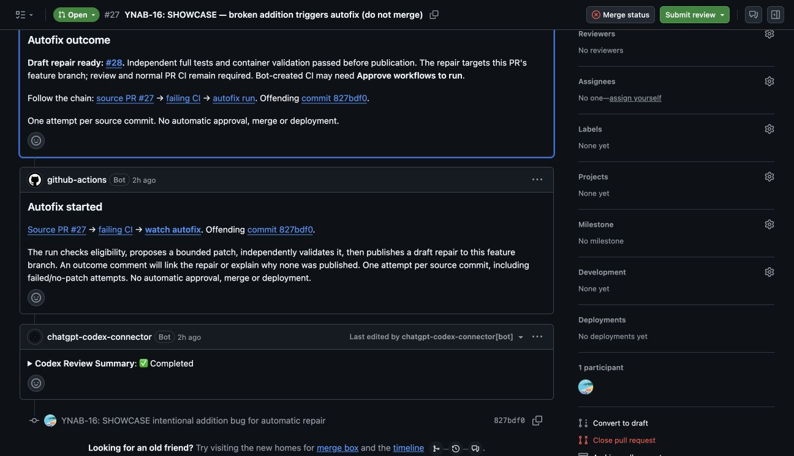

# Autofix: recorded example and repeatable live demo

This is the durable record of the actual 16 November 2026 demonstration. The
original PRs are closed without merging, with both branches retained. Their
original open state is preserved in the captured evidence, not claimed as current.

## Follow the recorded example

1. [Source PR #27](https://github.com/tzehon/ynab-mcp/pull/27) introduced subtraction
   instead of addition: `addDemoIntegers(2, 3)` returned -1 instead of 5.
   Inspect [the source patch](source.patch).
2. [Failing CI](https://github.com/tzehon/ynab-mcp/actions/runs/43804309948) passed
   389 tests and failed the intended assertion. [Archived log excerpts](failure-excerpts.log)
   and [job results](failure-ci.json) preserve the evidence after run retention expires.
3. The bot's [start comment](https://github.com/tzehon/ynab-mcp/pull/27#issuecomment-6907364453)
   linked the [autofix run](https://github.com/tzehon/ynab-mcp/actions/runs/43804534734).
   All five jobs passed: admit → generate → validate → publish → report.
   See [archived job results](autofix.json).
4. Independent validation passed all 390 tests and container checks before
   publication. See [original validation excerpts](validation-excerpts.log).
5. The bot's [outcome comment](https://github.com/tzehon/ynab-mcp/pull/27#issuecomment-6907440861)
   linked [draft repair #28](https://github.com/tzehon/ynab-mcp/pull/28). Its
   [one-line patch](repair.patch) changes `-` to `+`; all four assertions stay intact.
6. [Normal repair CI](https://github.com/tzehon/ynab-mcp/actions/runs/43805071586)
   passed after maintainer workflow approval. [Archived job results](repair-ci.json)
   preserve that separate verification.



## Stable source references

| Version | Named tag | Exact commit |
| --- | --- | --- |
| Original bug | `demo/autofix-2026-11-16-broken` | `827bdf0a31a2b4de4daf917dbd838da32da718d0` |
| Generated repair | `demo/autofix-2026-11-16-repaired` | `629510c54fbd88ef05b883a7e0772d64273c9309` |

Retain `YNAB-16-showcase-addition` and
`YNAB-16-autofix-827bdf0a31a2b4de4daf917dbd838da32da718d0`.
Do not move these tags, merge the example into main, or deploy it.

## Run a new live demonstration

Use the pinned Node/npm versions and an authenticated `gh` CLI for the repository
owner. Run from a current checkout of this repository. No OpenAI key is needed
locally; the already configured workflow uses its existing secret.

Find the merged **YNAB-17: Archive autofix evidence and add repeatable demo command**
implementation PR. It carries the approved reusable demo scope and the
`autofix-demo-approval:v1` marker. Use its PR number below:

```sh
npm run demo:autofix -- --approval-pr NUMBER
npm run demo:autofix -- --approval-pr NUMBER --publish
```

The first command makes read-only GitHub checks and previews the operation.
The second creates two invented files on a unique branch from current main,
then opens a clearly named source PR. It does not alter your checkout. Publishing
starts CI and can incur the already configured API usage; there is no automatic
merge, deployment or retry loop.

Follow the new PR's **Autofix started** and **Autofix outcome** comments. Approve
the generated draft's normal workflow run if GitHub asks. Verify actual results;
future repository changes or provider limits can prevent a successful repair.
Save evidence, then close the new repair and source without merging. Delete only
their disposable branches; retain the original references listed above.

The command checks owner login, merged owner-authored approval PR, marker,
metadata syntax, enabled configuration and vacant demo paths. It resets every
acceptance entry to pending. It does not authenticate to Jira or prove that an
approval is still applicable: the operator must check that before publishing.
Do not use an unrelated approval PR. A failed publication reports its branch
and stage; inspect for an existing branch/PR before retrying. No automatic
cleanup or force update occurs. Old PRs and one-attempt claims are never reset.

## Evidence provenance and retention

[Provenance](provenance.json) records capture time and commits;
[PR metadata](pull-requests.json) records the pre-closure state;
[selected bot comments](bot-comments.json) preserve both automatic links.
Logs are selected verbatim excerpts, not complete logs. Environment listings,
raw model traces, private Jira metadata and unrelated output are omitted.
The screenshot is an actual browser capture before closure. This archive does
not contain budget data or credentials.

The [SHA-256 manifest](SHA256SUMS) covers the archived evidence files. From this
directory run `shasum -a 256 -c SHA256SUMS`. These hashes detect later changes;
they are not a provider signature or independent attestation.

GitHub Actions run/check/log/artifact retention is limited, including a maximum
of 90 days for public repositories under the current
[retention policy](https://github.blog/changelog/2026-10-01-actions-retention-now-covers-checks-runs-and-statuses/).
The generated patch artifact itself was retained for one day by this workflow.
The committed archive remains available with the repository; original run links
may eventually stop working. Reopening old PRs does not recreate expired evidence.
